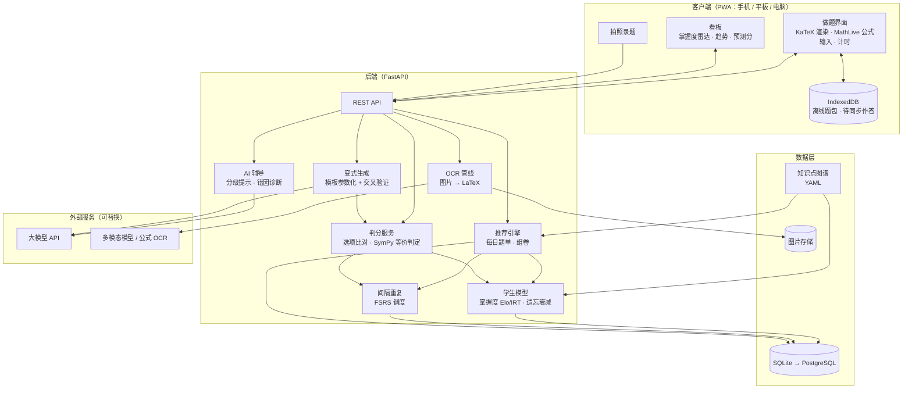
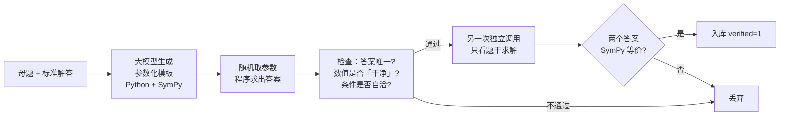

# 数·途 —— 定制化数学高考刷题应用：架构与技术路线

> 面向一名高三学生（2027 届）自用为主、可扩展为小范围共享的数学刷题系统。
> 核心目标不是「题多」，而是 **每一分钟都花在最能提分的题上**。

---

## 0. 先说结论（TL;DR）

| 问题 | 建议 |
|---|---|
| 做成什么形态？ | **PWA 网页应用**（手机 / 平板 / 电脑一套代码，可「添加到主屏幕」离线用） |
| 技术栈？ | 前端 React + TypeScript + Vite + KaTeX；后端 Python FastAPI + SQLite；数学校验用 SymPy；复习调度用 FSRS；AI 讲解调用国内可直连的大模型 API |
| 「定制化」靠什么？ | ① 知识点图谱 ② 每个知识点的掌握度模型（Elo/IRT 简化版）③ 错题间隔重复（FSRS）④ 按「考试分值 × 薄弱程度」排序的每日推荐 |
| 不要做什么？ | 不要上深度学习知识追踪（DKT 等）——只有你一个用户，数据量撑不起来；不要让 AI 凭空出题后不验证就做 |
| 时间怎么控制？ | **开发时间封顶**：MVP 两个周末，之后每周 ≤ 2 小时维护；寒假可集中做一次升级。刷题本身永远优先于写代码 |

---

## 1. 需求分析

### 1.1 考试约束（设计的出发点）

以新课标卷（2024 年起的新结构）为例，**先确认你所在省份用哪套卷**（新课标 I 卷 / II 卷，或北京、天津、上海等自主命题卷），题型结构写进配置文件，不要写死在代码里：

| 题型 | 题号 | 题数 × 分值 | 小计 | 特点 |
|---|---|---|---|---|
| 单选 | 1–8 | 8 × 5 | 40 | 追求速度和稳定 |
| 多选 | 9–11 | 3 × 6 | 18 | **部分得分**：两个正确选项时每选对一个得 3 分，三个时每选对一个得 2 分，有错选得 0 分 |
| 填空 | 12–14 | 3 × 5 | 15 | 只看结果，答案等价判定很关键 |
| 解答 | 15–19 | 13 + 15 + 15 + 17 + 17 | 77 | 按步骤给分，压轴常含新定义 / 综合题 |

由此得到几条直接影响设计的结论：

1. **分值权重不均**：系统推荐时必须乘上「这个知识点在卷面上值多少分」。
2. **多选题有策略空间**：需要一个「多选题保守 / 激进策略」的期望分计算器。
3. **填空题的判分要做数学等价**：`\frac{\sqrt{3}}{2}`、`√3/2`、`\dfrac12\sqrt3` 应判为同一个答案；但 `0.866` 这种近似值要判错，高考填空要的是准确值。
4. **解答题按步给分**：错题记录要精确到「第几问 / 哪一步」。
5. **时间是一等公民**：120 分钟 150 分，每道题都要记录用时。

### 1.2 功能需求

| 优先级 | 模块 | 说明 |
|---|---|---|
| P0 | 题库 | 题目录入（LaTeX）、知识点标签、难度、来源、标准解答 |
| P0 | 做题 | 公式渲染、计时、作答（选择 / 填空 / 解答自评）、提示 |
| P0 | 错题本 | 自动收录 + 错因标注 + 间隔重复复习 |
| P1 | 掌握度画像 | 每个知识点一个分数，雷达图 / 热力图 |
| P1 | 每日推荐 | 根据薄弱点、遗忘曲线、目标难度生成当天题单 |
| P1 | 数据看板 | 正确率趋势、用时分布、失分分布、预测分 |
| P2 | 拍照录题 | 手机拍卷子 → OCR → LaTeX → 人工校对入库 |
| P2 | AI 讲解 | 分级提示（方向 → 关键步 → 完整解），基于标准答案讲解 |
| P3 | 变式题生成 | 由母题生成参数化变式，经程序验证后入库 |
| P3 | 模考模式 | 按真实卷结构组卷，限时，出成绩报告 |

### 1.3 非功能需求

- **离线可用**：学校/通勤时没网也能刷已缓存的题。
- **低成本**：服务器 ≤ 几十元/月，或直接本机运行；AI 调用按量计费，每月预算封顶。
- **数据可导出**：所有数据能一键导出 JSON，不被锁死。
- **录入成本低**：录一道题 ≤ 1 分钟，否则你不会坚持。

---

## 2. 总体架构



**设计原则**

1. **核心逻辑不依赖 AI**：题库、判分、掌握度、推荐、复习调度全部是确定性代码；AI 只负责「讲解」和「辅助录入 / 出题」，挂了也不影响刷题。
2. **单体优先**：一个 FastAPI 进程 + 一个 SQLite 文件就够了。不要上微服务、消息队列、K8s。
3. **知识点图谱是数据，不是代码**：用 YAML 维护，改标签不用改程序。
4. **所有算法参数可配置**：方便你根据自己的情况调。

---

## 3. 知识点图谱

整个系统的「坐标系」。按人教 A 版新教材（必修第一、二册，选择性必修第一、二、三册）+ 高考常考题型整理，分三层：

```
模块（12 个左右）
 └─ 知识点（约 120–180 个）
     └─ 方法 / 题型（约 300 个，如「端点效应」「设而不求」「错位相减」）
```

参考模块划分：

| 模块 | 典型知识点 / 方法 | 卷面大致位置 |
|---|---|---|
| 集合与常用逻辑用语 | 集合运算、充要条件 | 单选前段 |
| 复数 | 四则运算、模、几何意义 | 单选前段 |
| 不等式 | 基本不等式、一元二次不等式 | 渗透各处 |
| 函数概念与性质 | 单调性、奇偶性、周期性、对称性、抽象函数 | 单选 / 多选 |
| 指对幂函数 | 比较大小、零点 | 单选 |
| 三角函数与解三角形 | 图像变换、恒等变换、正余弦定理、最值 | 小题 + 解答题 |
| 平面向量 | 数量积、投影、坐标运算 | 小题 |
| 数列 | 通项、求和（裂项、错位相减）、递推 | 解答题 |
| 立体几何 | 空间向量、二面角、外接球、截面 | 小题 + 解答题 |
| 直线与圆、圆锥曲线 | 离心率、弦长、定点定值、设而不求 | 小题 + 解答题 |
| 计数原理与概率统计 | 排列组合、二项式、分布列、期望、条件概率 | 小题 + 解答题 |
| 导数及其应用 | 单调性、极值最值、恒成立、零点、隐零点、构造 | 小题 + 压轴 |
| 新定义 / 创新题 | 阅读理解型综合 | 压轴 |

**图谱还要有「前置关系」边**，例如 `导数.恒成立 ← 导数.单调性 ← 函数.单调性`。用途：如果你在「恒成立」上一直错，系统会先检查前置知识点是否掌握，避免「在上层反复撞墙」。

```yaml
# data/knowledge_graph.yaml（片段）
- id: deriv.monotonic
  name: 利用导数判断单调性
  module: 导数及其应用
  exam_weight: 4.0        # 每套卷大约贡献的期望分值，后续用真题统计校准
  prereq: [func.monotonic, deriv.basic_rules]
- id: deriv.always_true
  name: 恒成立与能成立问题
  module: 导数及其应用
  exam_weight: 6.0
  prereq: [deriv.monotonic, deriv.extremum]
  methods: [分离参数, 端点效应, 必要性探路]
```

`exam_weight` 的校准方法：把最近 3 年你所在省份用的卷子（含各地模拟卷更好）逐题打标签，按「该题分值 ÷ 该题标签数」累加，再取平均。这一步做一次就够，**也是很好的考前复盘**。

---

## 4. 数据模型

```sql
-- 知识点（由 YAML 同步进来）
CREATE TABLE knowledge_point (
  id TEXT PRIMARY KEY,           -- 'deriv.monotonic'
  name TEXT NOT NULL,
  module TEXT NOT NULL,
  exam_weight REAL DEFAULT 1.0
);
CREATE TABLE kp_prereq (kp_id TEXT, prereq_id TEXT, PRIMARY KEY (kp_id, prereq_id));

-- 题目
CREATE TABLE question (
  id INTEGER PRIMARY KEY,
  type TEXT CHECK (type IN ('single','multi','fill','solve')),
  stem TEXT NOT NULL,            -- Markdown + LaTeX
  options JSON,                  -- 选择题选项
  answer JSON NOT NULL,          -- 选择: ["B"]；多选: ["A","C"]；填空: {"latex": "...", "kind": "expr|interval|set"}
  solution TEXT,                 -- 标准解答（AI 讲解以此为依据）
  sub_parts JSON,                -- 解答题分问：[{"label":"(1)","points":6,"answer":...}, ...]
  difficulty REAL,               -- IRT 难度 b，初始由人工标签映射
  est_seconds INTEGER,           -- 建议用时
  source TEXT,                   -- '2025 新课标I卷 第18题' / '某市一模' / '变式'
  parent_id INTEGER REFERENCES question(id),  -- 变式题指向母题
  verified INTEGER DEFAULT 1,    -- AI 生成题必须验证通过才置 1
  created_at TEXT
);
CREATE TABLE question_kp (
  question_id INTEGER, kp_id TEXT, weight REAL DEFAULT 1.0,
  PRIMARY KEY (question_id, kp_id)
);

-- 每一次作答（最重要的表，所有分析都从这里来）
CREATE TABLE attempt (
  id INTEGER PRIMARY KEY,
  question_id INTEGER,
  session_id INTEGER,
  response JSON,                 -- 学生答案
  score REAL,                    -- 实际得分（多选部分分、解答题分问得分）
  max_score REAL,
  correct REAL,                  -- 0–1 的「表现分」，见 §5.2
  seconds INTEGER,
  hints_used INTEGER DEFAULT 0,
  error_type TEXT,               -- concept|method|calc|reading|time|guess
  note TEXT,                     -- 自己写的一句话反思
  created_at TEXT
);

-- 每个知识点的掌握度
CREATE TABLE mastery (
  kp_id TEXT PRIMARY KEY,
  theta REAL DEFAULT 0,          -- 能力值
  n_attempts INTEGER DEFAULT 0,
  last_practiced TEXT
);

-- 错题复习卡片（FSRS 状态）
CREATE TABLE review_card (
  question_id INTEGER PRIMARY KEY,
  fsrs_state JSON,               -- 稳定性、难度、到期时间等，由 fsrs 库序列化
  due TEXT,
  lapses INTEGER DEFAULT 0,
  suspended INTEGER DEFAULT 0    -- 连续多次轻松做对后可「毕业」
);

-- 练习 / 模考会话
CREATE TABLE session (
  id INTEGER PRIMARY KEY,
  kind TEXT,                     -- daily|topic|review|exam
  started_at TEXT, ended_at TEXT,
  plan JSON,                     -- 推荐引擎生成的题单及理由
  report JSON
);
```

题目也支持用 YAML 文件批量维护（方便用 Git 管理、在电脑上批量录入）：

```yaml
# data/questions/2025-xkb1-q14.yaml（文件名就是题目 id）
type: fill
source: 2025 新课标I卷 第14题
kps: [conic.eccentricity, conic.ellipse]   # 也可以写权重：{conic.eccentricity: 2, conic.ellipse: 1}
difficulty_label: 中档        # 基础 / 中档 / 较难 / 压轴
est_seconds: 300
stem: |
  已知椭圆 $C:\frac{x^2}{a^2}+\frac{y^2}{b^2}=1\ (a>b>0)$ ……
answer: '\frac{\sqrt{3}}{3}'   # 单引号里的反斜杠不用转义
answer_kind: expr             # expr 一个值 / set 多个值 / interval 区间 / equation 方程
hints:
  - 第一级提示
  - 第二级提示
solution: |
  ……
```

---

## 5. 核心算法

### 5.1 为什么不用深度知识追踪

DKT、AKT 这类模型需要成千上万名学生、上百万条作答记录才能训练好。你的场景是 **单用户、每天几十条数据**。这时简单、可解释、可手调的模型反而更准、更好用。选型：

| 组件 | 选型 | 理由 |
|---|---|---|
| 知识点掌握度 | Elo 式在线更新（等价于简化的 IRT-1PL） | 每做一题就更新，几十题就能收敛，参数含义直观 |
| 单题复习调度 | FSRS（有现成开源 Python 库） | 比 SM-2（Anki 旧算法）更准，专门为间隔重复设计 |
| 推荐 | 规则 + 打分函数 | 可解释：每道推荐题都能说出「为什么推它」 |

### 5.2 作答 → 表现分

不是简单的对/错，而是 0–1 的连续值：

```python
def performance(attempt, q) -> float:
    if q.type == "multi":
        r = attempt.score / attempt.max_score      # 部分得分按比例
    elif q.type == "solve":
        r = attempt.score / attempt.max_score      # 按分问得分
    else:
        r = 1.0 if attempt.score == attempt.max_score else 0.0

    if r > 0:
        r *= 0.85 ** attempt.hints_used           # 用了提示就打折
        if attempt.seconds > 1.5 * q.est_seconds:
            r *= 0.8                              # 做对但超时：考场上等于丢分
        r = min(r, {"sure": 1.0, "unsure": 0.7, "guess": 0.3}[attempt.confidence])
    if attempt.revealed:
        r = min(r, 0.3)                           # 没做出来、先看了答案
    return r
```

提交前选「有把握 / 不踏实 / 蒙的」：蒙对的题不该让掌握度大涨，「不踏实」的题即使做对也会进错题本。

### 5.3 掌握度更新（Elo / IRT）

预测做对概率：

$$P(\text{对}) = \sigma\Big(\sum_k w_k \theta_k - b_q\Big),\quad \sigma(x)=\frac{1}{1+e^{-x}}$$

其中 $\theta_k$ 是知识点 $k$ 的掌握度，$w_k$ 是该题在各知识点上的权重（归一化后和为 1），$b_q$ 是题目难度。

每次作答后：

$$\theta_k \leftarrow \theta_k + K_k \cdot w_k \cdot (r - P),\qquad K_k = \frac{K_0}{1 + 0.05\, n_k}$$

- $r$ 是 §5.2 的表现分；$K_0 \approx 0.4$；$n_k$ 是该知识点已做题数（越做越稳，步长越小）。
- 难度初值由人工标签映射：基础 −1.0、中档 0.0、较难 1.2、压轴 2.5。单用户数据不足以反推题目难度，**题目难度固定不更新**，只更新学生能力。
- **遗忘衰减**：长期不练的知识点向先验回归，用于推荐时的「有效掌握度」：

$$\theta_k^{\text{eff}} = \theta_k \cdot e^{-\Delta t / \tau},\quad \tau \approx 45\ \text{天}$$

- **前置诊断**：若某知识点连续 5 题 $r < 0.5$，检查其前置知识点；若前置的 $\theta$ 也偏低，推荐转向前置。

展示给学生时，把 $\theta$ 映射成直观的「做中档题的把握」：$\text{掌握度}\% = \sigma(\theta - 0) \times 100\%$。

### 5.4 错题间隔重复（FSRS）

每道错题（以及「做对但不踏实」的题）建一张复习卡。重做后的评分映射：

| 重做结果 | FSRS 评分 |
|---|---|
| 还是错 | Again |
| 对了但看了提示 / 明显超时 | Hard |
| 独立做对 | Good |
| 很快做对、思路清晰 | Easy |

```python
from fsrs import Scheduler, Card, Rating

scheduler = Scheduler(desired_retention=0.9)
card = Card()                                        # 新错题
card, log = scheduler.review_card(card, Rating.Good) # 重做后更新
# card.due 即下次复习时间
```

规则补充：

- 连续 3 次 Good/Easy 且间隔已超过 30 天 → 「毕业」，不再出现（考前最后一个月可以一键召回全部毕业题过一遍）。
- 同一母题的变式题共享一张卡的「到期」信号：到期时可以出母题，也可以出一道没做过的变式，**防止背答案**。

### 5.5 每日推荐

把「今天做什么」变成一个打分排序问题。

**第一步：给知识点打优先级**

$$\text{priority}(k) = \underbrace{\text{exam\_weight}_k}_{\text{值多少分}} \times \underbrace{\big(1 - \sigma(\theta_k^{\text{eff}})\big)}_{\text{有多薄弱}} \times \underbrace{\text{ready}_k}_{\text{前置是否已掌握}} \times \underbrace{\text{phase}_k}_{\text{当前复习阶段的侧重}}$$

- `ready_k`：前置知识点平均掌握度低于阈值时取 0.3，否则 1。
- `phase_k`：跟着学校复习进度走（一轮按章节、二轮按专题、三轮按套卷），在设置里选当前阶段和当前章节，正在复习的章节 × 1.5。

**第二步：在知识点内选题**

选预测做对概率落在 **60%–85%** 的题（「跳一跳够得着」区间，太简单浪费时间，太难打击信心也学不到东西）；优先没做过的题，再按来源可信度排序（真题 > 名校模拟题 > 已验证变式）。

**第三步：组装今日题单**（以 60 分钟为例，可配置）

| 时段 | 内容 | 占比 |
|---|---|---|
| 热身 | 2–3 道到期错题（FSRS） | 20% |
| 主体 | 优先级 Top 2 知识点的专项，每个 3–4 题 | 50% |
| 限时 | 1 组「8 单选限时 25 分钟」或「3 多选 + 3 填空限时 20 分钟」 | 30% |

每周末自动安排 1 次整卷模考（120 分钟）。

每道推荐题都附「推荐理由」，例如：「圆锥曲线·离心率：卷面约 5 分，你的把握 48%，已 9 天未练」。这能让你判断系统是否靠谱，也方便调参。

### 5.6 预测分

$$\mathbb{E}[\text{分数}] = \sum_{\text{题位 } i} \text{分值}_i \times \sum_k p_i(k)\, P(\text{对} \mid k, b_i)$$

- $p_i(k)$：第 $i$ 题位考知识点 $k$ 的概率，由 §3 中统计的近几年真题得到。
- $b_i$：该题位的典型难度。
- 解答题按分问拆开算（第一问通常远比第二问容易）。

用途：(1) 看趋势；(2) **按「每多投入 1 小时，预测分提升多少」排序知识点**——这是比「哪里最弱」更好的复习指南。预测分要和每次真实模考成绩对比，偏差持续超过 10 分就调参数。

### 5.7 多选题策略计算器

给定你对每个选项的把握，计算不同选法的期望得分。例：你确定 A 对，对 C 有 60% 把握，其余选项确定错；假设正确答案是 2 个或 3 个的可能各占一半：

```
只选 A   → 0.5 × 3（答案 2 个）+ 0.5 × 2（答案 3 个）              = 2.5 分
选 A、C  → 0.6 × [0.5 × 6（恰为 AC）+ 0.5 × 4（3 个中含 AC）] + 0.4 × 0 = 3.0 分
```

这个例子里，C 的把握超过 50% 就值得选。程序对所有选法枚举一遍，给出期望分最高的那个。

在模考报告里统计你「多选少选」与「多选错选」的分数损失，给出个人化建议（例如：「你的第三选项判断准确率 45%，没把握时只选确定项更划算」）。

---

## 6. 判分与答案校验

| 题型 | 判分方式 |
|---|---|
| 单选 | 选项比对 |
| 多选 | 按官方部分得分规则计算 |
| 填空 | LaTeX → SymPy 表达式 → 等价判定（见下） |
| 解答题 | 默认**按分问自评**（对照标准答案和评分要点勾选得分点）；可选上传手写照片让 AI 给参考分，但只作参考 |

填空题等价判定流程：

```python
import random
from sympy import simplify, N
from sympy.parsing.latex import parse_latex

def equivalent(student_latex: str, answer_latex: str) -> bool:
    a, b = parse_latex(normalize(student_latex)), parse_latex(normalize(answer_latex))
    try:
        if simplify(a - b) == 0:            # 符号层面相等
            return True
    except Exception:
        pass
    syms = a.free_symbols | b.free_symbols  # 含参数时用随机数值采样兜底
    for _ in range(8):
        subs = {s: random.uniform(0.5, 3) for s in syms}
        if abs(N(a.subs(subs)) - N(b.subs(subs))) > 1e-9:
            return False
    return True
```

- `normalize` 负责处理 `\dfrac`→`\frac`、全角符号、`√`、`π` 等。
- 区间、集合、多个答案（「$x=1$ 或 $x=2$」）在 `answer.kind` 中区分，分别处理。
- 输入端用 **MathLive** 提供公式键盘，避免手机上手打 LaTeX。

---

## 7. AI 模块

### 7.1 原则

1. **讲解必须基于标准解答**：把题干 + 标准解答 + 你的错误答案一起发给模型，让它「解释」而不是「从零做题」。大模型独立解压轴题仍会出错，基于答案讲解可靠得多。
2. **分级提示，不直接给答案**：
   - L1 方向：「这道题考的是什么？条件里哪一句最关键？」
   - L2 关键步骤：「试试设直线方程为 $x=my+t$，联立后用韦达定理」
   - L3 完整解答（会记录为「看了答案」，影响表现分）
3. **AI 输出的数字要能被程序复核**：凡是涉及计算结果的，用 SymPy 再算一遍。
4. **成本封顶**：每日调用次数和每月金额设上限；相同问题缓存回答。

### 7.2 错因诊断

每道错题让你从 6 类错因中选一个（AI 可以给建议，但**你自己选**，反思的过程本身就有用）：

| 代码 | 错因 | 系统的后续动作 |
|---|---|---|
| concept | 概念不清 | 推荐该知识点基础题 + 回看教材对应章节 |
| method | 方法没想到 | 推荐同方法的其他题、生成变式 |
| calc | 计算失误 | 加入「计算专项」，统计你最常错的运算类型 |
| reading | 审题错误 | 记录易漏条件类型（定义域、$a>0$、「整数」等） |
| time | 时间不够 | 加入限时训练 |
| guess | 不会，蒙的 | 等同于 method，且表现分封顶 |

一段时间后，看板上会出现你自己的「失分画像」，例如：「近 30 天失分中 38% 是计算失误，主要在圆锥曲线联立化简」——这比任何通用资料都更有针对性。

### 7.3 Prompt 骨架（讲解）

```text
你是一位耐心的高中数学老师。学生正在准备新高考数学。
【题目】{stem}
【标准解答】{solution}
【学生答案与过程】{response}
【学生请求的提示级别】{level}  （L1 / L2 / L3）

要求：
- 严格以标准解答的思路为准，不要另起炉灶；
- L1 只指出考点与关键条件，不出现任何计算结果；
- L2 给出关键的一步变形或辅助构造，不给最终答案；
- L3 给出完整、规范、可按步得分的解答，并指出学生出错的那一步；
- 数学公式用 LaTeX，行内用 $...$。
```

### 7.4 拍照录题（OCR）

```
拍照 → 裁剪/纠偏（前端 canvas） → 公式 OCR → LaTeX 草稿
     → 人工校对（左图右文对照编辑器） → 打知识点标签（AI 推荐 3 个，人工确认） → 入库
```

OCR 方案按「效果 / 成本」可选：多模态大模型（识别 + 结构化一步到位）、Mathpix 等商用公式 OCR（准确率高、按量付费）、Pix2Text 等开源方案（本地运行、免费、效果稍弱）。**接口抽象成一个 `OcrProvider`**，随时换。

### 7.5 变式题生成

AI 直接出题最大的风险是**题目本身有错**（条件矛盾、答案算错）。必须走带验证的管线：



适合模板化的题型：数列求和、解三角形、导数切线与单调区间、概率分布列、圆锥曲线离心率等。压轴新定义题不适合自动生成，用真题和名校模拟题。

---

## 8. 技术选型

| 层 | 选型 | 备选 | 理由 |
|---|---|---|---|
| 前端框架 | React + TypeScript + Vite | Vue 3 | 生态大、资料多 |
| UI | Tailwind CSS + shadcn/ui | Ant Design Mobile | 手机端好看、轻量 |
| 公式渲染 | **KaTeX** | MathJax | 渲染快，适合大量题目列表 |
| 公式输入 | **MathLive** | — | 网页公式键盘，手机友好 |
| 图表 | ECharts | Recharts | 雷达图、热力图、日历图开箱即用 |
| 离线 | PWA（Service Worker）+ IndexedDB（Dexie.js） | — | 无网刷题，联网后同步 |
| 后端 | **Python FastAPI** | Node.js | 数学生态（SymPy、NumPy、FSRS、OCR）都在 Python |
| ORM | SQLModel | SQLAlchemy | 与 FastAPI 配合最顺 |
| 数据库 | **SQLite** | PostgreSQL | 单用户一个文件，备份就是复制文件；多人用再迁移 |
| 数学引擎 | SymPy | — | 答案等价、变式验证 |
| 间隔重复 | `fsrs`（PyPI） | 自己实现 SM-2 | 现成、准确 |
| 大模型 | 国内可直连的大模型 API（OpenAI 兼容接口） | 本地小模型 | 用统一接口封装，方便切换和比价 |
| 部署 | 本机运行 → 国内轻量云服务器 + Docker | — | 自用阶段在家里电脑跑，同一 Wi-Fi 下手机访问即可 |

> 备选「零后端」方案：如果你只想要最小可用版本，可以做成纯前端 PWA，数据全存 IndexedDB，判分用前端的 math.js / Compute Engine（MathLive 自带），FSRS 用 `ts-fsrs`。缺点是 OCR、AI 讲解、变式生成要么不做，要么前端直接调 API（密钥会暴露，只适合自己用）。

---

## 9. 项目结构

```
gaokao-math/
├── ARCHITECTURE.md              # 本文档
├── data/
│   ├── knowledge_graph.yaml     # 知识点图谱
│   ├── exam_blueprint.yaml      # 试卷结构、题位-知识点分布
│   └── questions/               # YAML 题库（Git 管理）
├── server/
│   ├── main.py                  # FastAPI 入口
│   ├── models.py                # SQLModel 数据模型
│   ├── api/                     # questions / attempts / sessions / review / stats
│   ├── core/
│   │   ├── mastery.py           # §5.3 掌握度
│   │   ├── scheduler.py         # §5.4 FSRS 封装
│   │   ├── recommender.py       # §5.5 每日推荐
│   │   ├── predictor.py         # §5.6 预测分
│   │   └── grading.py           # §6 判分 / 等价判定
│   ├── ai/
│   │   ├── llm.py               # 统一大模型客户端（限额、缓存）
│   │   ├── tutor.py             # 分级提示 / 错因建议
│   │   ├── ocr.py               # OcrProvider 抽象
│   │   └── variants.py          # 变式生成与验证
│   └── tests/                   # 算法单元测试（尤其是判分）
├── web/
│   ├── src/
│   │   ├── pages/               # 今日 / 刷题 / 错题本 / 模考 / 看板 / 录题
│   │   ├── components/          # MathView(KaTeX) / MathInput(MathLive) / Timer / ...
│   │   ├── offline/             # Dexie 数据库 + 同步队列
│   │   └── api.ts
│   └── vite.config.ts           # 含 PWA 插件
└── scripts/
    ├── import_yaml.py           # YAML 题库 → 数据库
    ├── calibrate_weights.py     # 由真题标签统计 exam_weight
    └── backup.sh
```

### 主要接口

| 方法 | 路径 | 说明 |
|---|---|---|
| GET | `/api/today` | 生成 / 获取今日题单（含推荐理由） |
| GET | `/api/questions/{id}` | 题目详情（作答前不返回答案） |
| POST | `/api/attempts` | 提交作答 → 判分 → 更新掌握度与复习卡 → 返回结果 |
| POST | `/api/attempts/{id}/reflection` | 补充错因与反思 |
| POST | `/api/questions/{id}/hint?level=1` | 分级提示 |
| GET | `/api/review/due` | 到期错题 |
| POST | `/api/exams` | 按试卷结构组一套卷 |
| GET | `/api/stats/mastery` · `/trend` · `/prediction` · `/loss-breakdown` | 看板数据 |
| POST | `/api/import/photo` | 拍照录题（返回 LaTeX 草稿） |
| POST | `/api/sync` | 离线作答批量上传 |
| GET | `/api/export` | 全量数据导出 |

---

## 10. 实施路线（结合高三时间表）

现在是 10 月，距高考约 8 个月。**这个项目是为刷题服务的，不能反过来吃掉刷题时间。**

| 阶段 | 时间 | 交付 | 开发时长上限 |
|---|---|---|---|
| **M0 最小可用** ✅ 已实现 | 10 月下旬两个周末 | YAML 题库 + 知识点标签；做题页（KaTeX、计时、选择/填空判分）；错题本 + FSRS 复习；导入 50–100 道你最近做错的题 | 12 小时 |
| **M1 定制化** | 11 月 | 掌握度模型 ✅、每日推荐（带理由）✅、错因统计 ✅；还差：掌握度雷达图 | 每周 2 小时 |
| **M2 省力录入** | 寒假 | 拍照 OCR + 校对编辑器；AI 分级提示；离线 PWA | 寒假集中 2–3 天 |
| **M3 冲刺** | 3–4 月 | 模考组卷 + 成绩报告、预测分、多选策略分析、变式题生成 | 每周 ≤ 1 小时，只修 bug 和小功能 |
| **冻结** | 5 月起 | 停止开发，只用不改 | 0 |

M0 只需要做到一件事：**你每天打开它，它告诉你今天该复习哪几道错题**。光是这一点，就已经比纸质错题本强很多。

### 验收指标（判断这个工具到底有没有用）

- **错题复发率**：错题在复习中再次做错的比例，应随时间下降。
- **预测分误差**：预测分 vs 实际模考分，目标误差 ≤ 8 分。
- **专项提升**：被推荐最多的 3 个知识点，4 周后的正确率变化。
- **每日使用时长中，真正做题的占比**：应 > 85%，录题和看数据不要占太多时间。

---

## 11. 风险与对策

| 风险 | 对策 |
|---|---|
| 开发占用学习时间 | 每阶段设时长上限；M0 之后只做「每周用下来最痛的那一个点」 |
| 录题太累，坚持不下来 | 先只录错题；拍照 OCR 放 M2；题库里的真题可以按年份分批录 |
| AI 讲错 / 出错题 | 讲解基于标准答案；变式题双重验证；AI 内容标注来源；解答题 AI 评分只作参考 |
| 只刷系统推荐，视野变窄 | 推荐里固定保留 10–15% 的随机题；每周整卷模考不受推荐影响 |
| 版权 | 真题与教材题自用没有问题；若分享给同学，不要附带从商业教辅或付费网站搬来的解析；公开发布前需另行确认授权 |
| 数据丢失 | SQLite 文件每天自动备份到云盘；YAML 题库在 Git 里 |
| 隐私（若给同学用） | 账号体系、密码哈希、仅本人可见；参照本仓库「拾光手帐」的做法 |

---

## 12. 下一步

M0 和 M1 的大部分已经实现，怎么运行见 [README.md](README.md)。

1. 确认你所在省份的试卷类型，改好 `data/exam_blueprint.yaml`。
2. 把最近一个月的错题挑 30 道录进去（网页「录题」或直接写 YAML），并打上知识点标签——这一步本身就是一次复盘。
3. 用两周，再看要不要做 M2。
